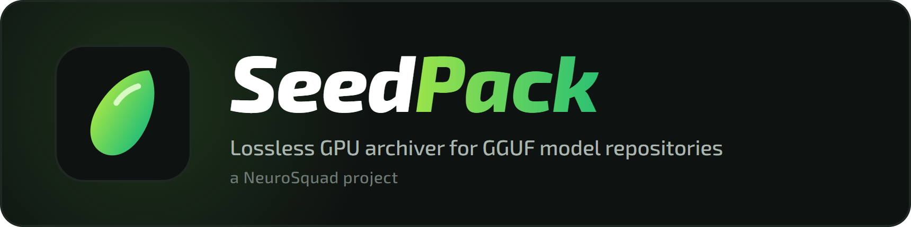

<p align="center"></p>

# SeedPack

**English** · [Русский](README.ru.md)

A lossless archiver for GGUF model repositories, by [NeuroSquad](https://huggingface.co/neurosquad). A whole repository — the BF16 model and all its quants from IQ1 to Q8 — packs into one archive about the size of a single compressed BF16 file. Every file is restored **bit-exactly**.

The idea: quants are not stored but "grown" from BF16, like a plant from a seed. llama.cpp quantizers are deterministic, so the archive reruns quantization on the GPU from BF16 with the repository's imatrix, using a bit-exact copy of `ggml-quants.c`. Only the difference from that result is stored, coded with the quantizer's own probabilities.

Ready archives on Hugging Face:
- [neurosquad/Qwen3-0.6B-SEEDPACK](https://huggingface.co/neurosquad/Qwen3-0.6B-SEEDPACK) — all of unsloth/Qwen3-0.6B-GGUF (BF16 and 25 quants, 10.95 GB) in one file, with a benchmark against 11 archivers;
- [neurosquad/Qwen3.5-9B-SEEDPACK](https://huggingface.co/neurosquad/Qwen3.5-9B-SEEDPACK) — all of unsloth/Qwen3.5-9B-GGUF (BF16, 21 quants and the vision projector, 147.8 GB) in 12.4 GB.

## Results

| What is compressed | Original | Archive | % | lmz 1.3.0 |
|---|---|---|---|---|
| all of unsloth/Qwen3.5-9B-GGUF (BF16 + 21 quants + 3 mmproj) | 147.81 GB | 12.40 GB | 8.39% | — |
| all of unsloth/Qwen3-0.6B-GGUF (BF16 + 25 quants) | 10.95 GB | 781.7 MB | 7.14% | 41.5% |
| all of unsloth/Qwen3.5-0.8B-GGUF | 14.08 GB | 1.12 GB | 7.96% | 41.2% |
| all of unsloth/Qwen3.5-2B-GGUF | 34.57 GB | 2.91 GB | 8.41% | 43.7% |
| Qwen3.5-2B quants only (21 files) + imatrix | 28.13 GB | 2.55 GB | 9.06% | 40.2% |
| Qwen3.5-2B quants only, no imatrix | 28.13 GB | 3.02 GB | 10.74% | 40.2% |
| a single Q8_0 (Qwen3-0.6B) | 639 MB | 576 MB | 90.1% | 93.0% |
| a single Q4_K_M (Qwen3-0.6B) | 397 MB | 372 MB | 93.8% | 95.0% |
| a single BF16 (Qwen3.5-2B) | 3.78 GB | 2.46 GB | 65.2% | 65.9% |

Speed, timings and all test sets are in `bench_competitors/VS_LMZ.md`; the roadmap is in `ROADMAP.md` (both in Russian).
Unpacking verifies checksums. Measured on an RTX 5070, a Core i7-8700K (6 cores, 12 threads) and an NVMe drive.

### Big models

A BF16 model larger than the GPU's memory (Qwen3.5-9B: 17.9 GB on a 12 GB card) is never held whole. All its quants are packed in one pass over windows of about 1 GB of tensors: each base tensor is read once for all files, and every file is read front to back. Unpacking decodes the base tensor by tensor on the GPU, so the BF16 file touches neither RAM nor disk unless it is extracted itself.

Qwen3.5-9B, the whole repository (147.8 GB), on two SATA SSDs in a stripe (about 1 GB/s):

| | Time | Speed |
|---|---|---|
| pack | 210–230 s | 640–700 MB/s |
| extract Q4_K_M (5.7 GB) | about 20 s | |
| extract all 28 files | 227 s | 650 MB/s |
| test all 28 files (no writes) | 120–140 s | 1.1–1.2 GB/s |

Peak GPU memory is 9.5 GB when packing and 6.3 GB when unpacking, process memory under 20 GB. Extracting one quant reads the whole coded BF16 model (11.7 GB) and writes the quant, so it takes about as long as the disks need for that.

## Installation

```
pip install seedpack
```

You need an NVIDIA GPU (Turing or newer) with a CUDA 13 driver (R580+) and Python 3.11+. The CUDA Toolkit is not needed: NVRTC, nvJitLink and the CUDA headers come from pip. Tested on an RTX 5070 under Windows 10 (Python 3.11) and Ubuntu on WSL2 (Python 3.14). Archives are portable between operating systems: one packed on Windows unpacks bit-exactly on Linux, and the other way round. On the first run the quantizers are compiled for your GPU (about 15 s) and cached in `%LOCALAPPDATA%\seedpack\cache` (or `~/.cache/seedpack`, or `SEEDPACK_CACHE`).

## Usage

```
seedpack pack   INPUTS... -o archive.seedpack     # files and/or folders
seedpack unpack ARCHIVE [NAMES|MASKS] -o DIR      # everything or selected files (alias: x)
seedpack list   ARCHIVE
seedpack test   ARCHIVE [NAMES|MASKS]             # unpack in memory and verify
```

ARCHIVE is a `.seedpack` file or an archive on Hugging Face: `hf://OWNER/REPO[/FILE.seedpack][@REVISION]` or an `https://huggingface.co/...` link. `list` reads only the index over the network; `unpack` and `test` download the archive once into the Hugging Face cache.

Examples:
```
seedpack x hf://neurosquad/Qwen3-0.6B-SEEDPACK Qwen3-0.6B-Q4_K_M.gguf -o models
seedpack pack models/Qwen3-0.6B-GGUF -o qwen3.seedpack
seedpack x qwen3.seedpack "*IQ1*" README.md -o out
```

File roles are detected automatically:
- a GGUF with more than half of its weights in BF16 is a base (the model, mmproj);
- the other GGUFs are derived from the bases; quants without a BF16 model are derived from the highest quant (the seed, `seedpack/seed.py`);
- identical tensors in different files are stored once;
- all other files are compressed with LZMA or zstd.

Every file is verified with BLAKE3 (SHA-256 if the package is missing), every archive chunk with CRC32.

## Development

```
git clone https://github.com/glmn-ai/seedpack && cd seedpack
python -m venv .venv
.venv\Scripts\pip install -r requirements.txt -e .
sh seedpack/ggml/build.sh         # CPU quantizer library (MinGW gcc): only the research scripts need it
python -m seedpack --help         # same as the seedpack command
```

The IQ grid tables (`seedpack/ggml/iqtables.npz`) are built by the CPU library and ship in the package; without the file they are rebuilt (about 25 s, needs `ggmlq.dll`).

Publishing: `python -m build`, then `twine upload dist/*`.

## Code layout

- `seedpack/cli.py` — the CLI (`seedpack`, or `python -m seedpack`); `seedpack/container.py` — the `.seedpack` format (chunks plus an index at the end, random access).
- `seedpack/repo3.py` — the core: M28/M29 (bases, quant prediction, residuals, pipeline).
- `seedpack/gpuquant.py` — CUDA code generated from `ggml-quants.c`, bit-exact with the CPU; quantizer variants of older llama.cpp versions.
- `seedpack/ptxfix.py` — a workaround for a ptxas bug in division by a constant.
- `seedpack/bf16v2.py` — the BF16 codec (R2); `seedpack/gpu_bf16.py` — M24.
- `seedpack/gpu3.py` (based on `seedpack/gpu2.py`) — M21/M22: a Q8_0 codec without a base (context rANS, row prediction from similar rows).
- `seedpack/seed.py` — the seed: the highest quant of a set without BF16, and its codec.
- `seedpack/qr.py` — QR: GPU coding of the residual with the quantizer's probabilities (scales, then codes), and the same coder without a seed for single files.
- `seedpack/requant.py` — CPU quantizers via `ggmlq.dll`, imatrix loading (legacy `.dat` and GGUF).
- `bench*.py`, `results*.json` — measurements of all methods M1–M29; `research/` — codec research.
- `bench_competitors/` — comparison with other archivers: `run_bench.py`, `quant_sets.py`, `vs_lmz.py`; `hf_bench.py` and `hf_card.py` — the benchmark and the card of the Qwen3-0.6B release on Hugging Face.
- `assets/` — the logo (`logo.svg`), the banner (`banner.png`, source `banner.html`) and the stats banners of the Hugging Face releases (`stats-*.png`); `bench_competitors/hf_banners.py` renders and compresses them.
- `seedpack/ggml/` — llama.cpp quantization sources (MIT, see `seedpack/ggml/LICENSE`).

## Limitations

- An NVIDIA GPU is required.
- Quants without a BF16 model: the highest quant becomes the seed (most bits per weight: UD-Q8_K_XL, Q8_0, … Q4); its tensors are dequantized and the other quants are derived from them. Without an imatrix the quantizers run with unit weights or without weights, whichever gives the smaller residual for each tensor. The Qwen3.5-2B quant set without BF16 and imatrix (21 files, 28 GB) compresses to 17%; lmz reaches 40%.
- If the published imatrix differs from the one used for quantization (as with Qwen3.5), some blocks are predicted inexactly. Correctness does not suffer, only the size grows: for Qwen3.5-2B all quants together cost 33 MB.
- Tested on Windows 10 and Ubuntu (WSL2) with an RTX 5070; other GPUs are on the roadmap (ROADMAP, item 22).

## License

Apache-2.0 (`LICENSE`). The llama.cpp / ggml quantization sources in `seedpack/ggml/` are MIT, see `NOTICE`.
